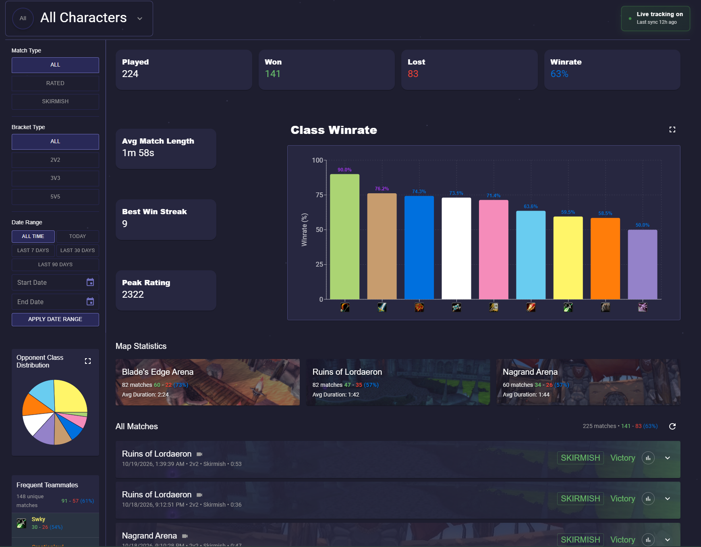

<p align="center">
  
</p>

<h1 align="center">WoWStats</h1>

<p align="center">
  Every arena match, broken down. A desktop companion for World of Warcraft arena players.
</p>

<p align="center">
  <a href="https://github.com/WoW-Stats/WoWStatsReleases/releases/latest"><strong>Download the latest release</strong></a> ·
  <a href="https://wowstats.app">Website</a> ·
  <a href="https://discord.gg/gjvQKPWgEn">Discord</a>
</p>



This repository hosts the WoWStats installers and the feed the app updates itself from. Grab the latest version from the [Releases page](https://github.com/WoW-Stats/WoWStatsReleases/releases/latest).

## What it does

WoWStats reads your combat log and its bundled WoWStatsLogger addon while you play, so every arena match is stored and analyzed on your PC:

- Win rates, frequent teammates and opponents, the comps you play and face, and map statistics
- A scoreboard, ability timeline, death log and replay for every match
- Matchup analysis by your comp, partner and enemy setup
- Automatic arena recording, no OBS needed
- Classic Era, TBC, Wrath, Cata, MoP and Retail, each kept separate

## Download

| Platform | File | Auto-updates |
|---|---|---|
| Windows 10 and 11 (x64) | `wowstats_<version>_x64-setup.exe` | Yes |
| Linux (x64) | `wowstats_<version>_amd64.AppImage` | Yes |
| macOS | Not available yet | |

The `.sig` files and `latest.json` are used by the in-app updater; you do not need to download them.

## Install

### Windows

1. Download `wowstats_<version>_x64-setup.exe` from the [latest release](https://github.com/WoW-Stats/WoWStatsReleases/releases/latest) and run it.
2. If Windows SmartScreen shows "Windows protected your PC", click **More info**, then **Run anyway**.
3. Start WoWStats and follow the setup wizard: choose your World of Warcraft folder and let it install the WoWStatsLogger addon.

### Linux

1. Download `wowstats_<version>_amd64.AppImage` from the [latest release](https://github.com/WoW-Stats/WoWStatsReleases/releases/latest).
2. Make it executable and run it:

   ```bash
   chmod +x wowstats_*_amd64.AppImage
   ./wowstats_*_amd64.AppImage
   ```

3. In the setup wizard, choose the World of Warcraft folder inside your Wine prefix, e.g. `~/Games/battlenet/drive_c/Program Files (x86)/World of Warcraft`.

WoW must run as an X11 or XWayland window (the Wine default) for live match tracking. Arena recording and playback use the system GStreamer; on Arch install:

```bash
sudo pacman -S --needed gstreamer gst-plugins-base gst-plugins-good gst-plugins-bad \
  gst-plugin-pipewire gst-plugin-va gst-libav
```

plus your GPU's VA-API driver (`libva-mesa-driver` for AMD, `intel-media-driver` for Intel). On other distributions, install the equivalent GStreamer base, good, bad, PipeWire, VA-API and libav plugin packages.

## Updates

WoWStats checks this repository for new versions and installs them for you. Every update is signed, and the app refuses one that does not verify. You can also check by hand in Settings.

Installs of v0.3.7 or older cannot verify newer updates; download and install the latest release by hand once.

## Help and feedback

Report bugs and suggest features through "Report an issue" in the app, or on [Discord](https://discord.gg/gjvQKPWgEn). When reporting a bug, attach the latest log file from Settings > Storage > Open Logs Folder.
